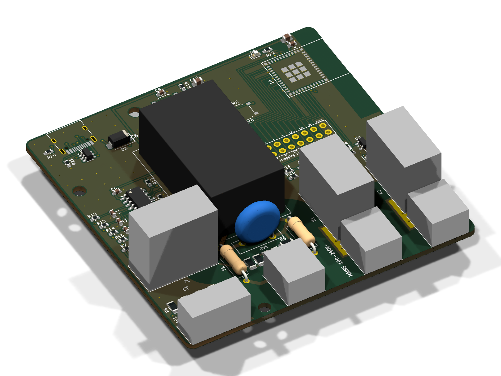
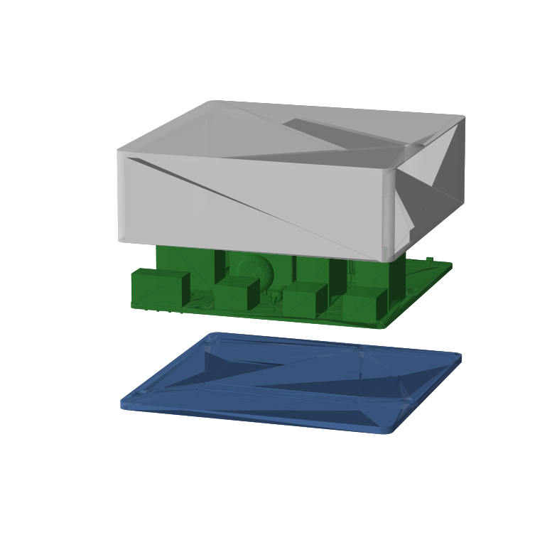

# C6 Energy Relay

A Wi-Fi AC energy meter with two relays, for Home Assistant through ESPHome. It measures line voltage
and two CT-clamp currents (BL0939), switches two loads or two contactor coils (16 A relays, 10 A use),
and is built fully assembled by JLCPCB. It mounts on a DIN rail in a 3D-printed case inside a plastic
junction box.

| | |
|---|---|
| MCU | ESP32-C6-MINI-1-N4 (Wi-Fi 6, BLE, Thread/Zigbee capable), PCB antenna |
| Metering | BL0939 on UART (GPIO16/17, 4800 baud): voltage, 2 x current, 2 x power, energy |
| Voltage sense | ZMPT107-1 current transformer, 5 x 22 k from the line, 22 R load |
| Current sense | 2 CT clamps with bare leads (100 A : 50 mA type), 0.6 R burden each |
| Relays | 2 x Hongfa HF32FV-16 (16 A SPST-NO), use up to 10 A; dry contacts |
| Supply | HLK-PM01 isolated 5 V 600 mA (100-240 V), or USB-C on the bench |
| Board | 80 x 80 mm, 2 layers, all parts on top |
| Terminals | pluggable: 3 x 5.08 mm 15 A (mains, relay 1, relay 2), 1 x 3.81 mm 4-pole (CTs) |
| GPIO | every unused GPIO on a 2 x 9 header footprint (holes only) |

## Safety

**This board connects to mains voltage.** Build, wire and install it only if you are competent to do
mains work, and power it only inside its case, inside a closed plastic enclosure.

- Mains and the low-voltage side are separated by 6.5 mm creepage and clearance (checked by KiCad's
  creepage DRC on every build). The HLK-PM01, the ZMPT107-1 and the relays are the isolation barrier.
- Both input lines are fused by 10 R 1 W fusible resistors, with a 10D561K MOV after the fuses.
- USB-C, the CT terminal and the GPIO header are on the isolated side. Even so, **do not connect USB to
  a board that is wired to mains**: flash it on the bench first, then use OTA.
- No protective earth: the board and case are meant for a plastic enclosure only.
- The relays are rated 16 A; keep loads at or below 10 A and use an external contactor above that.

## Wiring

All terminals are along the bottom edge and unplug, so wire the plugs before plugging them in.
Left to right, looking at the component side:

| Terminal | Pins | Use |
|---|---|---|
| J4 (3.81 mm) | CT1+, CT1-, CT2+, CT2- | the two CT clamps (low voltage) |
| J1 (5.08 mm) | L, N/L2 | supply and voltage reference |
| J2 (5.08 mm) | COM, NO | relay 1, dry contact |
| J3 (5.08 mm) | COM, NO | relay 2, dry contact |

- **120 V line-neutral:** L to `L`, neutral to `N/L2`.
- **240 V leg-leg (US split phase):** L1 to `L`, L2 to `N/L2`. Both inputs are fused, so either way
  works. The voltage reading then is the leg-leg voltage.
- **Relays:** dry contacts, so they switch whatever you wire through them (for example `L` -> COM,
  NO -> load). A contactor coil goes the same way.
- **CTs:** clamp each CT round one conductor. If a channel reads negative power, turn the clamp round
  or swap its two wires.

## Firmware

[`firmware/c6-energy-relay.yaml`](firmware/c6-energy-relay.yaml) is a starter ESPHome config: BL0939
sensors, `Relay 1` / `Relay 2` switches (off after a reboot), the status LED and the BOOT button
(toggles relay 1). Add a `secrets.yaml` with `wifi_ssid`, `wifi_password`, `api_key`, `ota_password`
and `ap_password`, then flash over USB-C (native USB, no buttons needed) and use OTA after that.

**Calibration:** with a known resistive load and a meter, set the `*_cal` substitutions to
(meter reading / reported value); the energy sensors use the power factors. The voltage factor
starts at 1.13 because this board loads the
ZMPT107 with 22 R where Seeed's meter uses 24.9 R.

| GPIO | Use | GPIO | Use |
|---|---|---|---|
| 16 | UART TX to BL0939 RX | 22 | relay 1 |
| 17 | UART RX from BL0939 TX | 23 | relay 2 |
| 12 / 13 | USB D- / D+ | 2 | status LED |
| 9 | BOOT button | 8 | 10 k pull-up (download mode) |

The header (J6, holes only) carries 3V3, 5V, GND and GPIO 0, 1, 3, 4, 5, 6, 7, 8, 14, 15, 18, 19, 20,
21; the silkscreen marks the strapping pins (4, 5, 8, 15) with `*`.

## Ordering at JLCPCB

Files are in [`hw/out/jlc`](hw/out/jlc):

1. PCB: upload `gerbers.zip` (2 layers, 1.6 mm, 1 oz, any colour, HASL).
2. Assembly: **Standard PCBA** (the board has through-hole parts), top side, upload `bom.csv` and
   `cpl.csv`. Check every part's orientation in JLC's placement preview before paying, above all the
   ESP32-C6 module, USB-C, the BL0939, the LDO (U3) and ESD chip (U4: 180 degrees off shorts VBUS
   to GND), the diodes, the transistors and both buttons (90 degrees off holds EN or BOOT low).
3. Plugs: add the loose plugs from `plugs.csv` to the same order as parts (3 x DB2EK-5.08-2P and
   1 x WJ15EDGK-3.81-4P per board).

Cost estimate (live part prices on 2026-11-21; fees, PCB and shipping are estimates, see
[`cost.md`](hw/out/jlc/cost.md)):

| Boards | Total | Per board |
|---|---|---|
| 10 | $228 | $22.81 |
| 20 | $363 | $18.13 |
| 30 | $470 | $15.66 |
| 50 | $693 | $13.86 |
| 100 | $1207 | $12.07 |

## Case

[`case/case.py`](case/case.py) (build123d) makes two parts from the board's own feature export:

- **base**: the back plate that clips onto a TS35 rail. A fixed hook at the top, a sprung latch at
  the bottom. Lever the latch out with a screwdriver in the lower slot to take it off the rail.
- **cover**: the front shell. The board screws to its four pillars from the solder side
  (4 x M3 x 8, self-tapping into 2.8 mm holes); the base then screws onto the cover from the back
  (4 x M3 x 4 into the corner bosses). The plugs stick out through the bottom wall, USB-C through
  the top. The front face is closed; the status LED shows through a 0.6 mm window.

Print in PETG (the latch flexes), 0.2 mm layers, 3 walls, no supports: the base flat on its inside
face (clip up), the cover on its front face. STEP and print-oriented STL files are in
[`case/out`](case/out).

## Building it from source

Everything is generated by scripts; edit the scripts, not the KiCad files.

| Step | Command |
|---|---|
| part check, datasheets | `python -m hw.tools.fetch_datasheets key=C123...` (optional) |
| symbols, footprints | `KPY hw/gen_lib.py` then `python -m hw.gen_3d` |
| schematic, project | `python -m hw.gen_sch` |
| board (placement, rules, zones) | `KPY hw/gen_pcb.py` |
| tracks, zone fill | `KPY hw/route.py` (routes are in `hw/routes.py`, laid out by hand) |
| board STEP | `kicad-cli pcb export step --drill-origin --subst-models -o hw/out/board.step hw/c6-energy-relay.kicad_pcb` |
| JLC files | `KPY hw/export_jlc.py` |
| case | `python case/case.py --preview` |
| tests | `python -m pytest` (KiCad ERC, DRC with creepage and schematic parity, JLC files, case fit, ESPHome config) |

`KPY` is KiCad 10's Python: `"C:\Program Files\KiCad\10.0\bin\python.exe"`. The circuit lives in
[`hw/design.py`](hw/design.py) and the parts in [`hw/parts.py`](hw/parts.py); the schematic, board,
BOM and firmware pin check all read from them. The design notes are in
[`docs/superpowers/specs`](docs/superpowers/specs).

Hardware tests (flashing, measuring, switching) happen once boards arrive.
